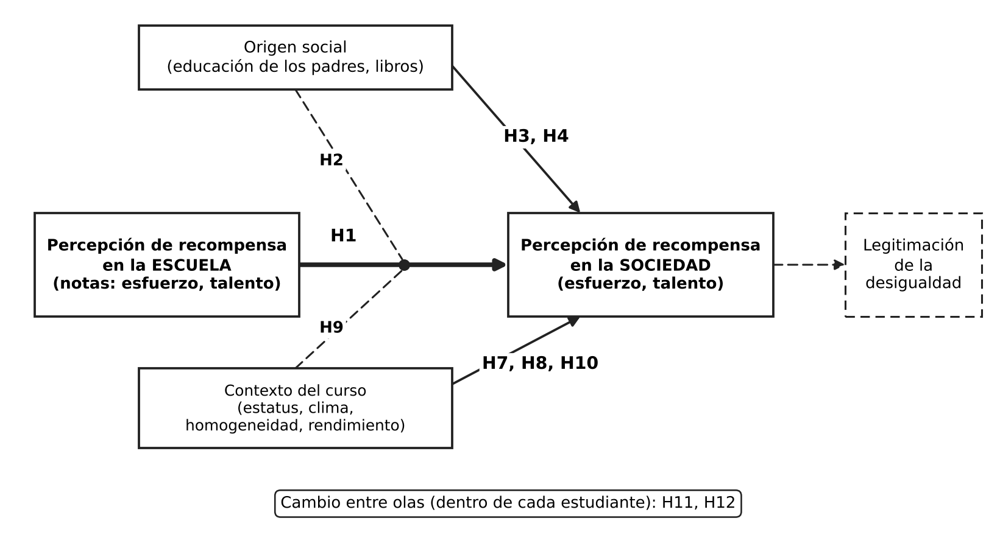

```{r}
#| label: setup
#| include: false
library(haven)
library(tidyverse)
library(scales)

# ---- Carga de datos ----
base_dir <- if (dir.exists("input")) {
  "input"
} else {
  normalizePath("C:/Users/InBOT/Downloads", winslash = "/", mustWork = FALSE)
}

load_dataset <- function(dataset_name) {
  candidates <- c(file.path(base_dir, paste0(dataset_name, ".sav")),
                  file.path(base_dir, paste0(dataset_name, ".RData")))
  for (file_path in candidates) {
    if (!file.exists(file_path)) next
    if (grepl("\\.sav$", file_path, ignore.case = TRUE)) return(read_sav(file_path))
    env <- new.env(parent = emptyenv())
    load(file_path, envir = env)
    objs <- ls(env)
    if (length(objs) == 0L) stop("El archivo RData está vacío: ", file_path)
    return(get(objs[[1]], envir = env))
  }
  stop("No se encontró el archivo para ", dataset_name, ". Busqué .sav y .RData en: ", base_dir)
}

data_long <- load_dataset("edumer_students_long")

# ---- Identidad gráfica EDUMER ----
rojo <- "#D32F2F"; rojo_o <- "#7F1D1D"; carbon <- "#4A4A4A"; tinta <- "#2B2B2B"; gris <- "#E6E6E6"
dv_lab  <- c(p1_1 = "Esfuerzo recompensado", p1_2 = "Talento recompensado")
col_dv  <- setNames(c(carbon, rojo), dv_lab)
etq_lik <- c("1 Muy en desacuerdo", "2 En desacuerdo", "3 De acuerdo", "4 Muy de acuerdo")
rampa3  <- c("#F6D5D5", "#D32F2F", "#7F1D1D")
rampa4  <- c("#F6D5D5", "#E89A9A", "#D32F2F", "#7F1D1D")
etq_educ   <- c("No terminó básica", "Básica", "Media", "Técnico/profesional", "Universidad", "Posgrado")
etq_libros <- c("0-10", "11-25", "26-100", "100-200", "201-500", "Más de 500")
etq_lik_c  <- c("Muy en desacuerdo", "En desacuerdo", "De acuerdo", "Muy de acuerdo")

theme_set(
  theme_minimal(base_size = 12) +
    theme(text = element_text(colour = tinta),
          plot.title = element_text(face = "bold", size = 13, colour = rojo),
          plot.subtitle = element_text(colour = carbon, size = 10),
          plot.caption = element_text(colour = carbon, size = 8, hjust = 0),
          panel.grid.minor = element_blank(),
          panel.grid.major = element_line(colour = gris, linewidth = 0.3),
          strip.text = element_text(face = "bold", colour = tinta),
          strip.background = element_rect(fill = "#FBEAEA", colour = NA),
          legend.position = "top", legend.title = element_blank())
)

# ---- Ola 2 completa (misma base de los contrastes bivariados) ----
ola2 <- data_long %>%
  zap_labels() %>%
  mutate(across(everything(), ~ ifelse(. %in% c(88, 99), NA, .))) %>%
  group_by(id_estudiante) %>%
  fill(d3_def, .direction = "downup") %>%
  ungroup() %>%
  filter(ola == 2) %>%
  mutate(class_id = cur_group_id(), .by = c(d2, d3_def)) %>%
  mutate(
    ola = factor("Ola 2", levels = c("Ola 1", "Ola 2")),
    # estatus socioeconómico: promedio de la educación de la madre y del padre
    ed_parent = case_when(
      !is.na(p26) & !is.na(p27) ~ (p26 + p27) / 2,
      !is.na(p26) ~ as.numeric(p26),
      !is.na(p27) ~ as.numeric(p27),
      TRUE ~ NA_real_),
    # nota merecida: quien declara que su promedio fue el merecido (p5 = 2) tiene C = A
    p6 = case_when(p5 == 2 ~ p4, TRUE ~ p6),
    J  = log(p4 / p6),
    # versiones categóricas para graficar
    estatus = cut(ed_parent, c(0, 2.5, 3.5, 4.5, 6),
                  labels = c("Básica o menos", "Media", "Técnica o profesional", "Universitaria o más")),
    madre   = factor(p26, 1:6, etq_educ),
    libros  = factor(p30, 1:6, etq_libros),
    nota_b  = cut(p4, c(0, 5, 5.5, 6, 6.5, 7), right = FALSE, include.lowest = TRUE,
                  labels = c("< 5,0", "5,0 a 5,4", "5,5 a 5,9", "6,0 a 6,4", "6,5 a 7,0")),
    j_b     = cut(J, c(-Inf, -0.05, 0.05, Inf),
                  labels = c("Sub-recompensado", "Nota justa (J = 0)", "Sobre-recompensado")),
    perc_esf  = factor(p2_1, 1:4, etq_lik_c),
    perc_tal  = factor(p2_2, 1:4, etq_lik_c),
    bsm_f     = factor(p2_3, 1:4, etq_lik_c)
  )

# ---- Funciones gráficas ----
# Distribución de respuestas (barras 100%), Ola 2
dist_cat <- function(df, vars, items, etq, colores, titulo) {
  tab <- df %>%
    select(all_of(vars)) %>%
    pivot_longer(everything(), names_to = "item", values_to = "resp") %>%
    filter(!is.na(resp)) %>%
    count(item, resp) %>%
    group_by(item) %>% mutate(N = sum(n), pct = n / N) %>% ungroup() %>%
    mutate(etiq = paste0(items[match(item, vars)], " (n=", N, ")"),
           etiq = factor(etiq, levels = unique(etiq[order(match(item, vars))])),
           resp = factor(resp, levels = seq_along(etq), labels = etq),
           oscuro = as.integer(resp) > ceiling(length(etq) / 2))
  ggplot(tab, aes(x = pct, y = etiq, fill = resp)) +
    geom_col(width = 0.62, colour = "white", linewidth = 0.5, position = position_stack(reverse = TRUE)) +
    geom_text(aes(label = ifelse(pct >= 0.05, percent(pct, accuracy = 1), ""), colour = oscuro),
              position = position_stack(vjust = 0.5, reverse = TRUE), size = 3) +
    scale_colour_manual(values = c("TRUE" = "#ffffff", "FALSE" = tinta), guide = "none") +
    scale_fill_manual(values = setNames(colores, etq), guide = guide_legend(nrow = 2, byrow = TRUE)) +
    scale_x_continuous(labels = percent, expand = c(0, 0)) +
    scale_y_discrete(limits = rev, labels = label_wrap(45)) +
    labs(title = titulo, subtitle = "% de respuestas válidas, Ola 2", x = NULL, y = NULL) +
    theme(plot.margin = margin(5.5, 18, 5.5, 5.5))
}

# Histograma, Ola 2
hist_ola <- function(df, v, binwidth, titulo, xlab, ref = NULL) {
  x <- df %>% filter(!is.na(.data[[v]]))
  m <- mean(x[[v]])
  p <- ggplot(x, aes(x = .data[[v]])) +
    geom_histogram(binwidth = binwidth, fill = rojo, colour = "white", linewidth = 0.3) +
    geom_vline(xintercept = m, linetype = "dashed", colour = tinta) +
    annotate("text", x = m, y = Inf, label = paste0("media = ", round(m, 2)),
             vjust = 1.6, hjust = -0.15, size = 3, colour = carbon, fontface = "italic") +
    labs(title = titulo, subtitle = paste0("Ola 2 (n = ", nrow(x), ")"), x = xlab, y = "Estudiantes")
  if (!is.null(ref)) p <- p + geom_vline(xintercept = ref, colour = carbon, linewidth = 0.4)
  p
}

w_ic <- function(k, n, lado, z = 1.96) {
  p <- k / n
  centro <- (p + z^2 / (2 * n)) / (1 + z^2 / n)
  mitad  <- z * sqrt(p * (1 - p) / n + z^2 / (4 * n^2)) / (1 + z^2 / n)
  if (lado == "lo") centro - mitad else centro + mitad
}

largo_dv <- function(d, x, dvs = c("p1_1", "p1_2")) {
  d |> select(ola, nivel = all_of(x), all_of(dvs)) |>
    pivot_longer(all_of(dvs), names_to = "dv", values_to = "y") |>
    filter(!is.na(nivel), y %in% 1:4) |>
    mutate(dv = factor(dv_lab[dv], levels = dv_lab))
}

# % de acuerdo (3-4) con IC de Wilson, según un predictor categórico/ordinal
fp <- function(p) ifelse(is.na(p), "p = NA", ifelse(p < .001, "p < 0,001", paste0("p = ", sub("\\.", ",", sprintf("%.3f", p)))))
rho_txt <- function(x, y, metodo = "spearman") {
  r <- asoc(x, y, metodo = metodo)
  paste0("ρ = ", sub("\\.", ",", sprintf("%.2f", r$coef)), "; ", fp(r$p))
}
etq_dv <- c(p1_1 = "Esfuerzo", p1_2 = "Talento")
rho_caption <- function(d, num, dvs) {
  paste(vapply(dvs, function(v) paste0(etq_dv[[v]], ": ", rho_txt(d[[num]], d[[v]])), ""), collapse = "   |   ")
}
acuerdo_segun <- function(d, x, titulo, xlab = NULL, dvs = c("p1_1", "p1_2"), num = NULL) {
  ylab <- if (length(dvs) == 1) paste0("% que cree que en la sociedad\nse recompensa el ", tolower(etq_dv[[dvs]]))
          else "% que cree que en la sociedad\nse recompensa el esfuerzo / el talento"
  r <- largo_dv(d, x, dvs) |>
    group_by(ola, dv, nivel) |>
    summarise(n = n(), k = sum(y >= 3), .groups = "drop") |>
    mutate(p = k / n, lo = w_ic(k, n, "lo"), hi = w_ic(k, n, "hi"))
  ggplot(r, aes(nivel, p, colour = dv, group = dv)) +
    geom_linerange(aes(ymin = lo, ymax = hi), position = position_dodge(.35), linewidth = .5) +
    geom_line(position = position_dodge(.35), linewidth = .5, alpha = .7) +
    geom_point(aes(size = n), position = position_dodge(.35)) +
    scale_colour_manual(values = col_dv, name = "En la sociedad se recompensa:", labels = c("el esfuerzo", "el talento"),
                        guide = if (length(dvs) == 1) "none" else "legend") +
    scale_size_area(max_size = 5, guide = "none") +
    scale_y_continuous(labels = percent, limits = c(0, 1)) +
    scale_x_discrete(labels = label_wrap(12)) +
    labs(title = titulo, x = stringr::str_wrap(xlab %||% x, 55), y = ylab,
         caption = "Punto: % de acuerdo (3-4) en cada grupo del eje horizontal.\nBarras: IC 95%. Tamaño = n.")
}

# Asociación ordinal: tau-b de Kendall (por defecto) o rho de Spearman, con IC 95% (aproximación de Fisher)
asoc <- function(x, y, min_n = 10, metodo = c("kendall", "spearman")) {
  metodo <- match.arg(metodo)
  ok <- complete.cases(x, y); x <- x[ok]; y <- y[ok]; n <- length(x)
  if (n < min_n || sd(x) == 0 || sd(y) == 0)
    return(tibble(n = n, coef = NA_real_, ic_inf = NA_real_, ic_sup = NA_real_, p = NA_real_))
  ct <- suppressWarnings(cor.test(x, y, method = metodo, exact = FALSE))
  r  <- unname(ct$estimate)
  se <- if (metodo == "kendall") sqrt(0.437 / (n - 4)) else sqrt(1.06 / (n - 3))
  tibble(n = n, coef = r, ic_inf = tanh(atanh(r) - 1.96 * se), ic_sup = tanh(atanh(r) + 1.96 * se), p = ct$p.value)
}

# Contexto: curso (Ola 2)
curso2 <- ola2 %>% group_by(class_id) %>%
  summarise(n_est = n(), ses_cm = mean(ed_parent, na.rm = TRUE), ses_de = sd(ed_parent, na.rm = TRUE),
            p1_1_cm = mean(p1_1, na.rm = TRUE), p1_2_cm = mean(p1_2, na.rm = TRUE), .groups = "drop")

disp_curso <- function(x, xlab, titulo) {
  r <- curso2 |> select(class_id, n_est, xc = all_of(x), p1_1_cm, p1_2_cm) |>
    pivot_longer(c(p1_1_cm, p1_2_cm), names_to = "dv", values_to = "y") |>
    mutate(dv = factor(unname(c(p1_1_cm = dv_lab[["p1_1"]], p1_2_cm = dv_lab[["p1_2"]])[dv]), levels = dv_lab)) |>
    filter(!is.na(xc), !is.na(y))
  est <- r |> group_by(dv) |>
    summarise(rho = cor(xc, y, method = "spearman"),
              p = suppressWarnings(cor.test(xc, y, method = "spearman", exact = FALSE)$p.value),
              n = n(), .groups = "drop") |>
    mutate(lab = sprintf("rho = %.2f; p = %.2f; %d cursos", rho, p, n))
  ggplot(r, aes(xc, y)) +
    geom_smooth(method = "lm", formula = y ~ x, se = FALSE, colour = carbon, linetype = "dashed", linewidth = .5) +
    geom_point(aes(size = n_est), colour = rojo, alpha = .8) +
    geom_text(data = est, aes(x = -Inf, y = Inf, label = lab), hjust = -.05, vjust = 1.5, size = 3,
              colour = carbon, inherit.aes = FALSE) +
    scale_size_area(max_size = 6, guide = "none") +
    scale_y_continuous(expand = expansion(mult = c(0.05, 0.18))) +
    facet_wrap(~ dv, labeller = as_labeller(c("Esfuerzo recompensado" = "Se recompensa el esfuerzo", "Talento recompensado" = "Se recompensa el talento"))) +
    labs(title = titulo, x = xlab, y = "Percepción en la sociedad:\nmedia del curso (1 a 4)",
         caption = "Un punto = un curso (Ola 2). Tamaño = n de estudiantes.\nLínea punteada: tendencia lineal descriptiva. 4 = muy de acuerdo.")
}
```


# Relevancia

## De las reformas educativas de la dictadura a la socialización meritocrática

- **Reformas en dictadura (1973-1990):** se aplicaron a la educación y la organizaron como un **cuasi-mercado**, con subvención a la demanda y competencia entre escuelas por la matrícula [@verger_recontextualizacion_2016a].
- **1. Las familias eligen y responden:** al ser un mercado, cada familia o individuo es responsable de la educación a la que accede, y su trayectoria se lee como **producto de su esfuerzo** [@canalesceron_sujeto_2022].
- **2. Las escuelas compiten por el rendimiento:** buscan atraer a estudiantes académicamente capaces, y el SIMCE publicado y la selección vuelven el resultado medible [@verger_recontextualizacion_2016a; @contreras_when_2010].
- **3. El mérito se hace visible:** notas y pruebas muestran quién tiene éxito, y éxito y fracaso se atribuyen al esfuerzo y la capacidad individuales [@rohde_assign_2023; @wiederkehr_belief_2015a].
- **¿Por qué en Chile especialmente?** El cuasi-mercado se aplicó **antes, por más tiempo y a mayor escala** que en otros países [@verger_recontextualizacion_2016a], y desde los ochenta la sociedad enfatiza el mérito [@palet_desiguales_2017].

::: {.notes}
Hilo: reforma, mercado, competencia por rendimiento, mérito visible, socialización meritocrática. Cada paso tiene fuente, pero el paso final (que esto produzca una socialización meritocrática en la sala de clases) es el argumento teórico de la tesis; ninguna fuente chilena lo prueba directamente. El "emprendedor de sí" de Canales et al. describe sobre todo las elecciones educativas de familias y jóvenes, no lo que ocurre dentro del aula. Contexto, si preguntan: el sistema resultante está altamente segregado por nivel socioeconómico (Duncan de 0,50 a 0,60 en 2008; Valenzuela et al.).
:::

## Cómo la escuela enseña que el mérito explica el resultado

- **Internalidad**: éxitos y fracasos escolares se explican por el esfuerzo y la capacidad individuales [@wiederkehr_belief_2015a; @darnon_where_2018].
- **Cuantificación del mérito**: notas y diplomas hacen parecer que el estatus es merecido [@rohde_assign_2023].
- **Recontextualización ideológica**: el origen social se transforma en diferencia individual (Bourdieu).
- Si el estudiante aprende en la escuela que el esfuerzo y el talento se recompensan, esa lectura puede **transferirse** a cómo interpreta la sociedad.

## Por qué importa percibir que el esfuerzo se recompensa

- Es una forma de **legitimar la desigualdad**: presenta la distribución desigual como resultado del mérito individual [@castillo_meritocracia_2019; @mijs_unfulfillable_2018].
- Creer en la meritocracia reduce la **percepción de injusticia** de la desigualdad social [@batruch_belief_2023].
- Esa percepción **se forma temprano, en la escuela** [@castillo_socialization_2024; @wiederkehr_belief_2015a].

# Antecedentes conceptuales y empíricos

## Mérito y percepciones de recompensa

- **Mérito = inteligencia + esfuerzo**, no factores adscriptivos (Young, 1958).
- La **percepción meritocrática** es la evaluación de en qué medida el esfuerzo y el talento se recompensan en la práctica [@castillo_multidimensional_2023].
- Se distingue de la **percepción de privilegio**: en qué medida el origen familiar y otros factores adscriptivos determinan los logros.
- Esta tesis estudia la percepción de que el **esfuerzo** y el **talento** son recompensados, por separado, en la escuela y en la sociedad.

## Evidencia de transferencia desde la escuela

- **Estudiantes chilenos de 8° básico** [@castillo_socialization_2024]:
    - En la escuela, **96,8%** está de acuerdo con que el esfuerzo es importante para obtener buenas notas (78,6% en el caso del talento).
    - En la sociedad, **62%** cree que el esfuerzo se recompensa y **63,7%** que el talento se recompensa.
- **Francia, estudiantes de secundaria (N = 242)** [@wiederkehr_belief_2015a]: explicar las notas por el esfuerzo se asocia con creer en una sociedad meritocrática y justa **solo entre estudiantes de bajo nivel socioeconómico y entre mujeres**.
- **Más de 40 países (N = 88.421)** [@batruch_belief_2023]: creer que la escuela es meritocrática se asocia con **menor percepción de injusticia** de la desigualdad social.

::: {.notes}
Cuidado con la comparación en Castillo et al.: el ítem escolar mide importancia del esfuerzo para las notas y el societal mide si se recompensa; no son equivalentes, por eso se presentan por separado y no como una brecha. Fuente de los datos: Primer Estudio Nacional de Formación Ciudadana 2017 (Agencia de Calidad), 5.047 estudiantes de 231 escuelas. Wiederkehr: estudio 1, b = 0,34 en bajo nivel socioeconómico y b = 0,21 en mujeres. Batruch: cuatro estudios, dos de ellos con encuestas internacionales.
:::

## Transferecia

- **Socialización escolar** [@wiederkehr_belief_2015a]: notas y evaluación inculcan la norma de internalidad. Se espera que lo que se percibe en la escuela **se transfiera** a la sociedad.
- **Legitimación del privilegio / capital cultural** [@castillo_meritocracia_2019]: los favorecidos reinterpretan sus ventajas heredadas como logro. Se espera **más** percepción con más estatus y capital cultural. En adultos, el ingreso se asocia con más percepción de meritocracia.
- **Efecto iluminador / función paliativa** [@castillo_socialization_2024; @wiederkehr_belief_2015a]: la educación da una mirada crítica, y los desfavorecidos dependen de la creencia escolar. Se espera **menos** percepción con más estatus, y una transferencia más fuerte en bajo nivel socioeconómico. En adultos, la educación (controlando el ingreso) se asocia con menos percepción.

::: {.notes}
H3 se formuló con expectativas rivales: legitimación (positiva) frente a efecto iluminador (negativa).
:::

## Modelo conceptual

{.r-stretch fig-align="center"}

<p style="font-size:0.5em;">Línea continua: efecto principal. Línea punteada que llega al punto sobre H1: interacción (moderación). Recuadro punteado: consecuencia teórica, no contrastada aquí.</p>

::: {.notes}
El eje es la transferencia (H1). Origen social y contexto del curso actúan como efectos principales (H3, H4, H7, H8, H10) y como moderadores de la transferencia (H2, H9). H11 y H12 estudian el cambio dentro de cada estudiante entre olas.
:::

# Pregunta y objetivos

## Pregunta de investigación

::: {.columns}
::: {.column width="58%"}
### Pregunta

¿En qué medida la percepción de que el esfuerzo y el talento son recompensados en la escuela se transfiere a la percepción de que lo son en la sociedad, y cómo varía esa transferencia según el origen social?
:::
::: {.column width="42%"}
### Objetivo general

Analizar la transferencia de la percepción de recompensa al esfuerzo y al talento desde la escuela a la sociedad, y su variación según factores individuales y contextuales.
:::
:::

## Objetivos específicos

1. **Transferencia:** estimar la asociación entre la percepción de recompensa en las notas y en la sociedad (H1).
2. **Origen social:** examinar si el estatus y el capital cultural se asocian con la percepción, y si moderan la transferencia (H2 a H4).
3. **Experiencia escolar:** analizar el rol del rendimiento, la justicia percibida y la creencia en la meritocracia escolar (H5 y H6).
4. **Contexto del curso:** evaluar los efectos contextuales y su moderación de la transferencia (H7 a H10).
5. **Cambio en el tiempo:** describir cómo cambia la percepción dentro de cada estudiante entre olas (H11 y H12).

# Hipótesis

## Hipótesis contrastadas bivariadamente

Cada hipótesis se formula para esfuerzo (a) y talento (b) por separado.

- **H1a-b:** más percepción de recompensa en las notas, **más** percepción equivalente en la sociedad (transferencia).
- **H3a-b:** la educación de los padres se asocia con la percepción de recompensa. Expectativas rivales: **positiva** (legitimación del privilegio) o **negativa** (efecto iluminador).
- **H4:** más libros en el hogar (capital cultural), **más** percepción de recompensa al **talento**.
- **H5a-b:** mayor rendimiento y justicia percibida en las notas, **más** percepción.
- **H6a-b:** mayor creencia en la meritocracia escolar, **más** percepción.

## Hipótesis para el análisis multinivel

- **H7a-b:** mayor **estatus promedio del curso**, más percepción, más allá del origen propio (efecto contextual).
- **H8a-b:** mayor **clima meritocrático** del curso, más percepción, más allá de la propia adhesión (efecto contextual).
- **H10a-b:** cursos **socioeconómicamente más homogéneos**, más percepción (efecto contextual, exploratoria).
- **H11:** la percepción de recompensa al esfuerzo **disminuye** dentro de cada estudiante entre olas (cambio intraindividual).
- **H12a-b:** mejorar el rendimiento o la justicia percibida respecto del propio promedio **aumenta** la percepción (efecto intraindividual).

## Hipótesis multinivel: interacciones (moderación)

Solo **dos** hipótesis son de interacción: plantean que el efecto de H1 **cambia según otra variable**. Ambas son exploratorias.

- **H2a-b:** percepción en las notas **×** nivel socioeconómico del estudiante. La transferencia (H1) es **más fuerte** en estudiantes de **menor** nivel socioeconómico (función paliativa).
- **H9a-b:** percepción en las notas **×** rendimiento promedio del curso. La transferencia (H1) se **atenúa** en cursos de **mayor** rendimiento promedio (efecto iluminador).

Interacción entre variables del mismo nivel (H2) y entre niveles (H9). Se contrastan con el **término producto** en los modelos mixtos.

# Metodología

## Datos y muestra

- **Panel EDUMER**: estudiantes de 6° básico a 2° medio.
- **12 establecimientos** y alrededor de **32 a 35 cursos**; el curso se identifica combinando establecimiento (`d2`) y curso (`d3_def`).
- Análisis bivariado actual con la **Ola 2** (n ≈ 670 con dato en las variables dependientes).
- Con 12 establecimientos **no se estiman efectos contextuales de escuela**; el contexto se define a nivel de **curso**, y la dependencia del establecimiento entra como control.
- Códigos 88 y 99 se tratan como datos perdidos.

## Variables

::: {.columns}
::: {.column width="50%"}
**Dependientes** (escala 1 a 4)

- Esfuerzo recompensado en Chile (`p1_1`)
- Inteligencia y habilidad recompensadas en Chile (`p1_2`)

Se analizan por separado, sin índice.

**Experiencia escolar**

- Recompensa en las notas (`p2_1`, `p2_2`)
- Creencia en la meritocracia escolar (`p2_3`)
- Promedio de notas (`p4`)
- Justicia percibida: J = ln(nota / nota merecida)
:::
::: {.column width="50%"}
**Origen social**

- Estatus: promedio de la educación de madre y padre
- Capital cultural: libros en el hogar (`p30`)

**Contexto (curso)**

- Composición socioeconómica (media)
- Heterogeneidad socioeconómica (desviación estándar)
- Clima meritocrático (media de BSM) y rendimiento promedio

**Controles**: dependencia del establecimiento, entre otros.
:::
:::

## Estrategia de análisis

::: {.columns}
::: {.column width="45%"}
**1. Bivariado (Ola 2)**

- Asociación ordinal: **rho de Spearman** con IC 95%
- % de acuerdo (categorías 3 y 4) con IC 95%
- A nivel de curso: Spearman sobre medias
:::
::: {.column width="55%"}
**2. Modelos mixtos (próxima etapa)**

- **Efectos contextuales (H7 a H10):** modelos mixtos con estudiantes anidados en cursos (intercepto aleatorio por curso). El estatus individual se centra en la media del curso para separar el efecto del contexto del origen propio.
- **Interacciones (H2 y H9):** término producto entre la percepción en las notas y el nivel socioeconómico individual (H2) o el rendimiento promedio del curso (H9, interacción entre niveles).
- **Cambio en el tiempo (H11 y H12):** modelos mixtos de medidas repetidas (olas anidadas en estudiantes), que separan la variación dentro de cada persona de la diferencia entre personas.
:::
:::

::: {.notes}
Los IC y p del bivariado ignoran la anidación; por eso son descriptivos. Se evaluará además un modelo mixto ordinal como análisis de robustez dado que la variable dependiente tiene 4 categorías.
:::

# Análisis bivariado

## Percepción de recompensa en la sociedad (Ola 2)

```{r}
#| label: g-dv-dist
#| fig-height: 3.6
#| fig-width: 9
dist_cat(ola2, c("p1_1", "p1_2"),
         c("Esfuerzo recompensado en Chile (p1_1)", "Inteligencia y habilidad recompensadas en Chile (p1_2)"),
         etq_lik, rampa4, "Percepción de recompensa en la sociedad")
```

## Magnitud de las asociaciones

```{r}
#| label: g-resumen
#| fig-height: 4.6
#| fig-width: 9.5
par_asoc <- function(df, hip, predictor, xvar, yvar)
  asoc(df[[xvar]], df[[yvar]], metodo = "spearman") |> mutate(hip = hip, predictor = predictor, vd = dv_lab[[yvar]])
efectos <- bind_rows(
  par_asoc(ola2, "H1", "Recompensa en las notas (misma dimensión)", "p2_1", "p1_1"),
  par_asoc(ola2, "H1", "Recompensa en las notas (misma dimensión)", "p2_2", "p1_2"),
  par_asoc(ola2, "H3", "Estatus: educación de los padres", "ed_parent", "p1_1"),
  par_asoc(ola2, "H3", "Estatus: educación de los padres", "ed_parent", "p1_2"),
  par_asoc(ola2, "H4", "Capital cultural: libros en el hogar", "p30", "p1_1"),
  par_asoc(ola2, "H4", "Capital cultural: libros en el hogar", "p30", "p1_2"),
  par_asoc(ola2, "H5", "Rendimiento: promedio de notas", "p4", "p1_1"),
  par_asoc(ola2, "H5", "Rendimiento: promedio de notas", "p4", "p1_2"),
  par_asoc(ola2, "H5", "Justicia percibida en las notas (J)", "J", "p1_1"),
  par_asoc(ola2, "H5", "Justicia percibida en las notas (J)", "J", "p1_2"),
  par_asoc(ola2, "H6", "Creencia en la meritocracia escolar (p2_3)", "p2_3", "p1_1"),
  par_asoc(ola2, "H6", "Creencia en la meritocracia escolar (p2_3)", "p2_3", "p1_2")
) |>
  mutate(etiqueta = paste0(hip, ": ", predictor),
         etiqueta = factor(etiqueta, levels = rev(unique(etiqueta))),
         vd = factor(vd, levels = dv_lab))
efectos <- efectos |> mutate(
  lab = paste0("ρ = ", sub("\\.", ",", sprintf("%.2f", coef)), "; ", fp(p)),
  sig = p < .05)
ggplot(efectos, aes(coef, etiqueta, colour = vd)) +
  geom_vline(xintercept = 0, colour = "#9a9892", linewidth = .4) +
  geom_point(position = position_dodge(width = .6), size = 2.8) +
  geom_text(aes(label = lab, fontface = ifelse(sig, "bold", "plain")),
            position = position_dodge(width = .6), hjust = -0.12, size = 3.1, show.legend = FALSE) +
  scale_colour_manual(values = col_dv) +
  scale_x_continuous(expand = expansion(mult = c(0.08, 0.55))) +
  scale_y_discrete(labels = label_wrap(38)) +
  labs(title = "Asociaciones bivariadas con la percepción de recompensa en la sociedad", x = "ρ de Spearman", y = NULL)
```

::: {.notes}
Los IC excluyen el cero en H1, H4, H6 y H5 (J). H3 se centra en cero. H5 (nota): solo talento excluye el cero.
:::

## Transferencia de las notas a la sociedad (H1)

```{r}
#| label: g-h1
#| fig-height: 3.5
#| fig-width: 6
#| layout-ncol: 2
acuerdo_segun(ola2, "perc_esf", "H1 · Esfuerzo: del colegio a la sociedad", "En el colegio, el esfuerzo es recompensado en las notas (p2_1)", dvs = "p1_1", num = "p2_1")
acuerdo_segun(ola2, "perc_tal", "H1 · Talento: del colegio a la sociedad", "En el colegio, el talento es recompensado en las notas (p2_2)", dvs = "p1_2", num = "p2_2")
```

::: {.interp}
La línea sube: quienes ven más recompensa en las notas también ven más recompensa en la sociedad (de cerca de 30-37% en "Muy en desacuerdo" a cerca de 65-72% en "De acuerdo"). El salto está entre los extremos bajos y las categorías de acuerdo; entre "De acuerdo" y "Muy de acuerdo" casi no cambia. Los grupos de desacuerdo son pequeños y sus barras largas.
:::

## Origen social (H3 y H4)

```{r}
#| label: g-h3
#| fig-height: 3.5
#| fig-width: 6
#| layout-ncol: 2
acuerdo_segun(ola2, "estatus", "H3 · Origen social: educación de los padres", "Educación de los padres (promedio de madre y padre)", num = "ed_parent")
acuerdo_segun(ola2, "libros", "H4 · Capital cultural: libros en el hogar", "Libros en el hogar", num = "p30")
```

::: {.interp}
Con la educación de los padres las líneas son casi planas: el estatus no distingue la percepción de recompensa. Con los libros en el hogar, el % tiende a bajar en los grupos con más libros, lo contrario de lo esperado en H4, aunque con barras largas en las categorías pequeñas.
:::

## Rendimiento y justicia percibida (H5)

```{r}
#| label: g-h5
#| fig-height: 3.5
#| fig-width: 6
#| layout-ncol: 2
acuerdo_segun(ola2, "nota_b", "H5 · Rendimiento: promedio de notas", "Promedio de notas (p4)", num = "p4")
acuerdo_segun(ola2, "j_b", "H5 · Justicia percibida de la propia nota", "Evaluación de la propia nota (J)", num = "J")
```

::: {.interp}
Las notas se asocian algo más con la percepción de recompensa al talento que con la del esfuerzo, con una pendiente leve. Quienes se ven sub-recompensados muestran menos acuerdo que quienes consideran justa su nota; los sobre-recompensados no se distinguen de estos últimos (barras muy largas).
:::

## Contexto del curso (H7 y H10)

```{r}
#| label: g-ctx
#| fig-height: 3.4
#| fig-width: 6
#| layout-ncol: 2
disp_curso("ses_cm", "Educación parental promedio del curso", "H7 · Contexto: composición socioeconómica del curso")
disp_curso("ses_de", "Desviación estándar de la educación parental en el curso", "H10 · Contexto: heterogeneidad socioeconómica del curso")
```

::: {.interp}
Nube de puntos sin una pendiente clara y sin asociaciones significativas: ni la composición ni la heterogeneidad socioeconómica del curso se asocian con su percepción promedio. Con pocos cursos y algunos muy pequeños, esto no descarta un efecto.
:::

# Referencias {.smaller .scrollable}

::: {#refs}
:::
